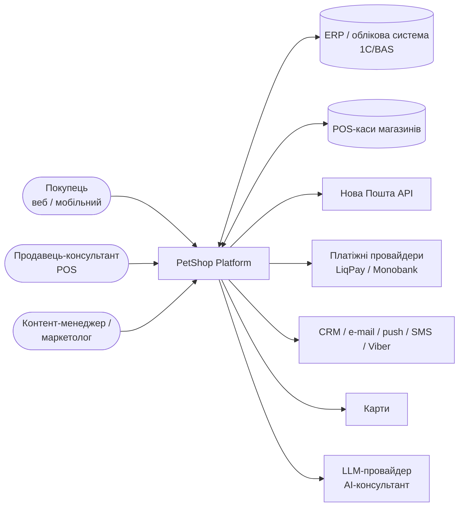
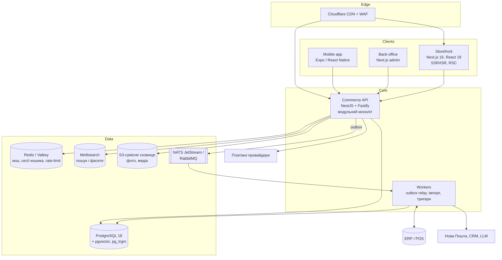
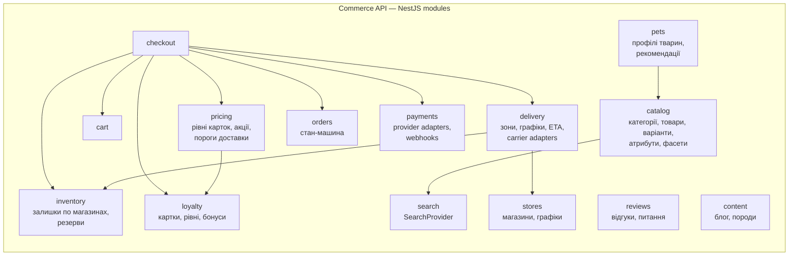
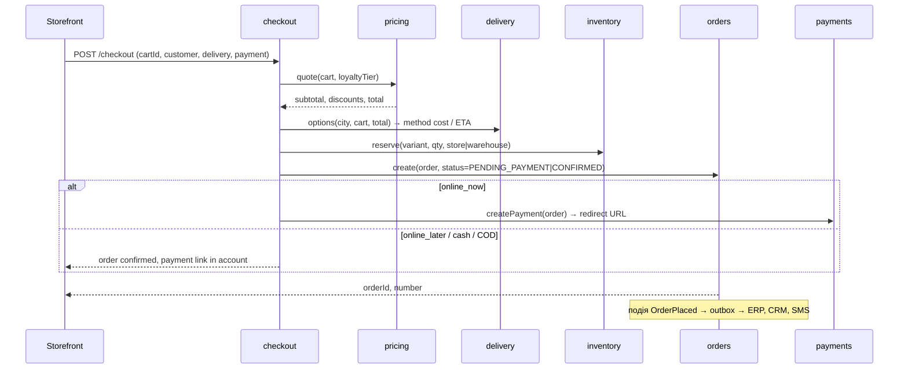

# PetShop Platform — Software Architecture Document (SAD) v0.1

Продукт-аналог омніканального зоомагазину (функціональний еталон — ZooBonus.ua, див. звіт зворотного інжинірингу). Документ описує цільову архітектуру та її реалізацію в MVP-прототипі (`apps/api`, `apps/web`).

## 1. Цілі та обмеження

**Бізнес-цілі**
1. Онлайн-продаж кормів і зоотоварів (собаки, коти, птахи, гризуни) + ветаптека.
2. Омніканальність: залишки по магазинах, самовивіз, єдина картка лояльності онлайн/офлайн.
3. Доставка 4 способами з ETA: власний кур'єр (зони, графіки), кур'єр перевізника, самовивіз з магазину, відділення перевізника.
4. Утримання клієнта: рівні лояльності, профіль тварини, персональні рекомендації, тригерні комунікації.

**Технічні цілі (відмінності від as-is)**
| As-is (ZooBonus) | To-be |
|---|---|
| Laravel + Livewire v2 + jQuery, server-driven UI | TypeScript full-stack: Next.js (RSC/SSR/ISR) + NestJS API-first |
| Варіанти ваги = окремі товари | Product → Variant, відгуки на рівні Product |
| JSON-LD лише WebPage | Product/Offer/AggregateRating/BreadcrumbList/LocalBusiness |
| Немає CSP, бібліотеки з CDN без версії | CSP, lock-файли, SRI, відсутність runtime-CDN для JS |
| Немає мобільного застосунку | Один API для вебу та Expo/React Native |
| Ручне дублювання даних (кількість магазинів тощо) | Single source of truth, похідні значення з БД |

**Обмеження:** персональні дані — Закон України «Про захист персональних даних» (+ GDPR-сумісні практики); платежі — лише через PCI DSS-сертифікованого провайдера (без зберігання PAN); мови — UK (за замовчуванням), EN.

## 2. C4 — Level 1: System Context

## 3. C4 — Level 2: Containers

## 4. C4 — Level 3: Components of Commerce API (bounded contexts)

Правило залежностей: модулі спілкуються лише через публічні сервіси (`*.service.ts`) або доменні події; прямий доступ до таблиць іншого модуля заборонений (перевіряється лінтером меж модулів). Це дозволяє пізніше винести модуль у сервіс без переписування.

### 4.1 Сценарій оформлення замовлення

## 5. Ключові бізнес-правила (реалізовані в прототипі)
| Правило | Модуль | Тест |
|---|---|---|
| Знижка за рівнем картки: MEMBER 3 %, PRESTIGE 5 %, SUPER 10 % (налаштовується) | pricing | `pricing.rules.test` |
| Акції: відсоткові на бренд/категорію; найвигідніша з картковою знижкою, без підсумовування (налаштовувана політика `best_of`) | pricing | ✓ |
| Безкоштовна доставка: сума **після знижок** ≥ поріг методу (кур'єр 1000 ₴, кур'єр перевізника і відділення — 3000 ₴; самовивіз з магазину — завжди безкоштовно); прапорець `freeShipping` на варіанті | pricing/delivery | ✓ |
| ETA: власний кур'єр — наступний день зони за графіком, якщо замовлення до cut-off (14:00), інакше +1 слот; перевізник — +2…3 дні; самовивіз — завтра, якщо є залишок у магазині, інакше переміщення +2 дні | delivery | ✓ |
| Ціна за одиницю: автоматично ₴/кг (ваговий товар) або ₴/шт | catalog | ✓ |
| Резерв товару при оформленні; зняття резерву через TTL при неоплаті | inventory | ✓ |
| Рекомендації корму за профілем тварини: вид, вік (кошеня/доросла/сеньйор), стерилізація, алергени → фільтр атрибутів + ранжування | pets | ✓ |

## 6. Сучасні технології та AI-функції
| Функція | Реалізація у цільовій системі | MVP-прототип |
|---|---|---|
| Пошук з українською морфологією, опечатками, синонімами | Meilisearch (typo-tolerance, синоніми) + PostgreSQL FTS | pg_trgm + ILIKE через `SearchProvider` |
| Семантичний пошук «корм для котика з чутливим травленням» | ембедінги в pgvector, гібридний ранжувальник (BM25 + vector) | інтерфейс `SemanticSearchProvider` (заглушка) |
| AI-консультант із підбору корму | LLM + RAG по каталогу та довідці про породи; guardrails: не дає ветеринарних діагнозів, пропонує звернутися до лікаря | rule-based рекомендатор із тим самим контрактом |
| Персоналізація | профіль тварини → рекомендації, тригери (день народження, «корм закінчується») | ✓ рекомендації, тригер «день народження» у моделі |
| Прогноз закінчення корму / автопідписка | розрахунок добової норми × вага пачки → нагадування / автозамовлення | у дорожній карті |
| Голосовий пошук | Web Speech API у браузері | у дорожній карті |
| PWA / мобільний застосунок | Expo Router, спільні типи API (OpenAPI → TS-клієнт) | OpenAPI-специфікація |

## 7. Нефункціональні вимоги (NFR)
| Категорія | Вимога | Механізм |
|---|---|---|
| Продуктивність | LCP < 2.5 с (p75 mobile), INP < 200 мс, TTFB PLP < 300 мс з CDN | RSC + ISR, кешування на edge, оптимізація зображень (AVIF/WebP) |
| API | p95 < 150 мс для каталогу, < 400 мс для checkout | індекси, Redis-кеш, денормалізовані read-моделі |
| Доступність | 99.9 % / місяць | 2+ репліки, health-checks, rolling deploy, керований PostgreSQL з HA |
| Масштабованість | 10× піки акцій (Black Friday) | горизонтальне масштабування stateless API, черги для інтеграцій |
| Безпека | OWASP ASVS L2; CSP з nonce; HSTS; rate-limit; OTP-вхід; секрети у vault | Fastify helmet, rate-limit, zod-валідація всіх входів |
| Персональні дані | мінімізація, згоди, право на видалення, шифрування at-rest | окрема схема PII, аудит-лог |
| Доступність UI | WCAG 2.1 AA | семантична розмітка, контраст, клавіатурна навігація |
| SEO | 1 H1, canonical, hreflang, sitemap на кожну мову, JSON-LD, 301-мапа | Next.js `metadata`, `sitemap.ts`, `robots.ts` |
| Спостережуваність | трасування запитів наскрізь, бізнес-метрики | OpenTelemetry → Grafana/Tempo/Loki або аналог |

## 8. Розгортання
* **Dev/CI:** PGlite in-process (без Docker) або `docker compose` (PostgreSQL+pgvector, Meilisearch, Valkey).
* **Prod:** контейнери (Kubernetes або керований PaaS), керований PostgreSQL, Cloudflare перед web/api, CI/CD: lint → typecheck → test → build → image → deploy з canary.
* Конфігурація через змінні середовища (12-factor), секрети — у vault провайдера.

## 9. Відповідність функцій ZooBonus → модулі аналога
| Функція ZooBonus (as-is) | Модуль аналога | MVP |
|---|---|---|
| Мегаменю (товари, бренди, ветаптека) | catalog (дерево категорій, тип `pharmacy`) | ✓ |
| Пошук з автопідказками | search | ✓ |
| Фасети (бренд, ціна, вага, протеїн, клас, вік…) | catalog + search | ✓ |
| Картка товару з варіантами ваги | catalog (Product→Variant) | ✓ |
| «В наявності в N магазинах» | inventory | ✓ |
| Блок доставки з ETA (4 способи) | delivery | ✓ |
| Кошик, «купити в один клік» | cart / checkout | ✓ (кошик, checkout) |
| Оплата LiqPay зараз / пізніше з кабінету, готівка, накладений платіж | payments | ✓ (адаптер-заглушка) |
| Картка лояльності MEMBER/PRESTIGE/SUPER | loyalty + pricing | ✓ |
| День народження улюбленця, профіль тварини | pets | ✓ |
| Відгуки, питання, фото покупців | reviews | ✓ відгуки |
| Магазини (місто, графік, рейтинг) | stores | ✓ |
| Блог, породи, фотогалерея | content (headless CMS) | дорожня карта |
| Обране | customers/favorites | дорожня карта |
| Callback, Viber/Telegram | integrations | дорожня карта |

## 10. Архітектурні рішення (ADR)
Див. каталог `docs/adr/`.
